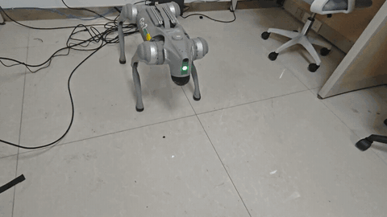
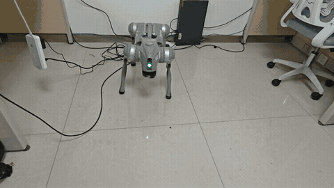

# go2-him-amp

面向 Unitree Go2，**自主设计并实现 HIM+AMP 融合框架**，将 HIM 状态估计与 AMP 动作先验接入统一训练流程，已完成 **Isaac Gym训练 → MuJoCo仿真 → Go2真机键盘部署**。保留可独立运行的 HIM 基线，并兼容原 PPO 路线。

[安装](doc/setup_zh.md) · [训练与部署指南](doc/training_deployment_zh.md) · [预训练权重](release/go2_him_flat_bounded_3000/README.md)

## 自主设计的 HIM+AMP 融合框架


融合架构与接口由本项目设计实现：保留 HIM 的状态估计和任务奖励，引入 AMP 判别器学习专家动作先验，通过附加风格奖励训练策略。HIM 和 HIM+AMP 分别使用独立任务、配置与权重，复用原 HIM 网络和 PPO 更新。

部署模型仅包含 Source Encoder 与 Actor，判别器、Critic、Target Encoder 和专家数据仅用于训练。HIM+AMP 已完成平地训练、仿真评估与 Go2 真机部署。

## 训练与真机演示

| Isaac Gym | MuJoCo | Go2真机 |
|:---:|:---:|:---:|
|  |  |  |

**策略部署真机演示**

| HIM | HIM+AMP |
|:---:|:---:|
|  |  |

HIM+AMP 演示使用平地训练 3000 轮的策略，键盘平移指令为 0.30 m/s。

## 项目能力

- **策略训练**：PPO、HIM，以及独立的平地 HIM+AMP；支持域随机化与断点续训，HIM 另提供混合地形配置。
- **HIM状态估计**：根据六帧本体观测估计3维速度和16维隐变量，与当前观测共同输入Actor。
- **AMP动作先验**：利用专家动作与判别器增加风格奖励，保留 HIM 原有任务奖励；判别器仅用于训练。
- **统一部署接口**：TorchScript模型配套导出观测顺序、缩放、关节映射和控制参数。
- **仿真评估**：支持速度跟踪、停步、扰动及脚端净空、接触滑移等指标。
- **真机控制**：SDK2 / DDS通信，支持键盘行走、受控降低、阻尼停止和运行日志。

## 模型接口

| 接口 | PPO | HIM | HIM+AMP |
|---|---:|---:|---:|
| 部署模型输入 | 45维 | 270维（6×45） | 270维（6×45） |
| Actor输入 | 45维 | 64维（45＋3＋16） | 64维（45＋3＋16） |
| Critic输入，仅训练 | 60维 | 238维 | 238维 |
| 动作输出 | 12维 | 12维 | 12维 |
| 本项目部署策略周期 | 20ms | 20ms | 20ms |
| 动作缩放 | 0.25 | 0.25 | 0.25 |
| 策略PD增益 | 20 / 0.5 | 20 / 0.5 | 20 / 0.5 |

## 快速开始

完成[环境安装](doc/setup_zh.md)后，从仓库根目录运行：

```bash
conda activate unitree-rl
export PYTHONPATH="$PWD${PYTHONPATH:+:$PYTHONPATH}"
```

### 运行HIM仿真

使用仓库内的配套模型和参数：

```bash
python -m deploy.deploy_mujoco.deploy_go2 \
  --config deploy/deploy_mujoco/configs/go2_him_flat_bounded.yaml \
  --command 0.3 0 0
```

添加 `--headless --no-realtime --duration 10` 可运行无窗口仿真。`--command`依次为前进速度、侧向速度和偏航角速度，单位为m/s、m/s、rad/s。

### 训练HIM

```bash
python legged_gym/scripts/train_him_from_scratch.py \
  --profile flat-bounded --run-dir logs/him/my_run \
  --headless --num_envs 2048 --max_iterations 3000 --seed 42
```

`flat-bounded`使用平地、有界动作和固定学习率，默认训练3000轮；`candidate-rough`和`candidate-flat`提供其他训练配置。训练记录和导出文件写入指定的运行目录。其他训练入口、续训和权重替换见[训练与部署指南](doc/training_deployment_zh.md)。

### 训练HIM+AMP

先按 [Go2 AMP 数据格式](datasets/go2_amp/README.md)准备专家动作和 `datasets/go2_amp/manifest.json`，再运行：

```bash
python legged_gym/scripts/train_him_from_scratch.py \
  --profile him-amp --run-dir logs/go2_him_amp/my_run \
  --amp-manifest datasets/go2_amp/manifest.json --amp-weight 1.0 \
  --headless --num_envs 2048 --max_iterations 3000 --seed 42
```

`him-amp` 使用独立的平地任务，在原 HIM 任务奖励上增加 `amp_weight × 控制周期 × 风格奖励`。动作数据保存在本地，不随仓库分发。原 HIM 继续使用 `flat-bounded`，两者共用部署接口。

### 真机键盘控制

从原厂站姿接管，具体连接与启动命令见[训练与部署指南](doc/training_deployment_zh.md#真机键盘控制)。

| 按键 | 功能 |
|---|---|
| W / S | 前进 / 后退 |
| A / D | 左移 / 右移 |
| Q / E | 前进并左转 / 右转 |
| X / 空格 | 速度归零 |
| C | 受控降低并退出 |
| Z / Ctrl+C | 阻尼停止并退出 |

HIM默认平移指令为0.30m/s，PPO统一模式前后为0.50m/s、侧移为0.40m/s；表中速度为指令值，实际运动速度随策略和运行条件变化。

HIM+AMP 复用同一键盘入口，通过配套配置和版本清单切换：

```bash
python -m deploy.deploy_real.go2_keyboard \
  --network eno1 \
  --config deploy/deploy_real/configs/go2_him_amp.yaml \
  --baseline deploy/deploy_real/configs/go2_him_amp_baseline.json \
  --speed-profile legacy --run
```

`eno1` 替换为实际有线网卡。W/S/A/D 对应前后左右，平移指令为 0.30 m/s。

## 项目结构

```text
legged_gym/
  envs/go2/                      PPO环境
  envs/go2_him/                  HIM环境、平地/地形配置与导出
  envs/go2_him_amp/              HIM+AMP环境与独立配置
  scripts/                       训练、续训、回放与评估入口
  utils/                         任务注册、Runner选择和公共工具
third_party/himloco_rsl_rl/rsl_rl/
  modules/                       HIM编码器、Actor和Critic
  algorithms/                    PPO/HIM参数更新
  runners/                       原HIM训练循环
  amp/                           判别器、动作数据、Replay和AMP训练适配
datasets/go2_amp/               本地专家动作与数据格式说明
deploy/
  common/                        策略接口、速度估计与反馈控制
  deploy_mujoco/                 MuJoCo运行、步态测量与评估
  deploy_real/                   DDS、控制状态机、键盘入口与配套配置
  pre_train/
    go2/                         PPO模型
    go2_him_flat_bounded/         当前HIM模型与接口参数
    go2_him_amp/                  HIM+AMP模型与接口参数
release/                        可单独下载的权重与配套参数
resources/                      URDF、MJCF与模型资产
tests/                          离线回归；fixtures仅供测试
doc/                            安装说明、框架图和演示GIF
logs/                           本地训练、评估、真机记录与历史归档
```

环境与状态采集放在 `legged_gym/envs/`，学习算法放在 `third_party/himloco_rsl_rl/`，部署层负责模型推理与控制接口。HIM+AMP 复用原 HIM 的网络和 PPO 更新，在独立的 `amp/` 中增加动作先验训练。

| 路线 | 训练选择 | 真机配置 | 模型目录 |
|---|---|---|---|
| PPO | `--task go2` | `configs/go2.yaml` | `pre_train/go2/` |
| HIM | `--profile flat-bounded` | `configs/go2_him_flat_bounded.yaml` | `pre_train/go2_him_flat_bounded/` |
| HIM+AMP | `--profile him-amp` | `configs/go2_him_amp.yaml` | `pre_train/go2_him_amp/` |

表中真机配置位于 `deploy/deploy_real/`，模型目录位于 `deploy/`。训练记录、专家动作、原始视频与历史归档保存在本地，不随 Git 分发。

本项目基于 [unitree_rl_gym](https://github.com/unitreerobotics/unitree_rl_gym)、[HIMLoco](https://github.com/InternRobotics/HIMLoco) 和 [AMP_for_hardware](https://github.com/escontra/AMP_for_hardware) 等开源实现开发，许可证见 [LICENSE](LICENSE)及 [AMP 来源记录](third_party/himloco_rsl_rl/rsl_rl/amp/upstream.json)。
